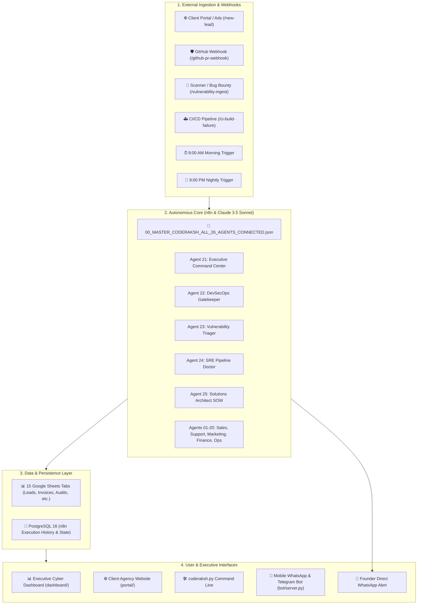

# 🏗️ CodeRaksh Company — Technical Architecture & System Design

> **Document Version:** 3.0.0  
> **Status:** ACTIVE & PRODUCTION-GRADE  
> **Maintainer:** CodeRaksh Engineering Team  

---

## 1. High-Level System Architecture

CodeRaksh operates as an autonomous multi-tier AI enterprise. All departmental automation pipelines are orchestrated through **n8n**, powered by **Claude 3.5 Sonnet**, and backed by **Google Sheets & PostgreSQL** for persistent state storage.

---

## 2. Component Topology

### A. The Ingestion Tier
1. **GitHub Webhooks:** Ingests Pull Request events, Commit diffs, and Actions CI logs.
2. **Client Portal Forms:** Accepts inbound inquiries and leads directly from `portal/index.html`.
3. **Scheduled Cron Triggers:**
   - `09:00 IST`: Morning Tactical Radar compilation.
   - `21:00 IST`: Nightly Boardroom Performance Audit and Health Score generation.
   - `08:30 IST`: Pre-market treasury and stock scanner.

### B. The Processing & AI Reasoning Tier (Claude 3.5 Sonnet)
- **Model Standard:** `claude-3-5-sonnet-20241022` / `claude-sonnet-5-5`.
- **Reasoning Framework:**
  - Fast Regex pre-scanners for deterministic secret detection (AWS keys, OpenAI tokens).
  - Deep LLM Semantic Evaluation for OWASP Top 10 vulnerabilities, business logic analysis, and code quality audits.
  - Strict JSON tool calling / structured output parsing where data must be stored in databases.

### C. The Data & State Storage Tier
- **Google Sheets (15 Tabs):** Serves as human-auditable, real-time CRM and operating ledger (`Leads`, `Orders`, `Bookings`, `Reviews`, `Content`, `Bills`, `Invoices`, `GST_purchases`, `Candidates`, `Deadlines`, `Pending_docs`, `Security_Audits`, `Vulnerabilities`, `Proposals`, `Daily_Log`).
- **PostgreSQL 16:** Backs n8n workflow execution logs, node states, and retry queues.

### D. The Dispatch & Presentation Tier
- **WhatsApp Cloud API:** Primary channel for high-priority founder alerts, client booking confirmations, and payment reminders.
- **Gmail OAuth2:** Delivers formatted PDF dossiers, SOW proposals, and candidate screening results.
- **REST Webhook Responses:** Delivers instantaneous (< 500ms) answers to interactive CLI, Telegram, and dashboard queries.

---

## 3. Mathematical Health Score Algorithm

The nightly executive audit executes a weighted algorithm to determine the company's real-time operational fitness:

$$\text{Health Score} = S_{\text{Finance}} + S_{\text{Sales}} + S_{\text{Support}} + S_{\text{Ops}}$$

| Dimension | Max Points | Evaluation Criteria |
|---|---|---|
| **Finance ($S_{\text{Finance}}$)** | **30** | Penalizes overdue invoices > ₹30K (-5) and > ₹100K (-10); Rewards positive daily cash flow (+5). |
| **Sales Pipeline ($S_{\text{Sales}}$)** | **25** | Rewards $\ge 2$ Hot leads (+10), inbound inquiries (+5), repeat orders (+5). |
| **Customer Delight ($S_{\text{Support}}$)** | **20** | Starts at 18; Deducts -10 per 1-star review; Adds +2 per 5-star review. |
| **Ops & Execution ($S_{\text{Ops}}$)** | **25** | Starts at 22; Deducts -5 for > 5 upcoming deadlines; Deducts -5 for blocked client documents. |

- **Score $\ge 80$:** 🟢 **HEALTHY** (Normal autonomous operation)
- **Score $60 - 79$:** 🟡 **ATTENTION NEEDED** (Focus on overdue collections & lead followup)
- **Score $< 60$:** 🔴 **CRITICAL ACTION REQUIRED** (Immediate founder fire-drill alert)

---

## 4. Security & Isolation Architecture

1. **Defense-in-Depth:** Credentials never reside in the codebase. All sensitive keys are injected via environment variables (`.env`).
2. **Local Pre-Commit Gating:** `coderaksh.py pr-check` catches accidental secret leaks before code leaves developer machines.
3. **Container Isolation:** Docker Compose runs n8n in a non-root environment with healthchecks and dedicated network boundaries.
