# 🌳 CodeRaksh Company — Autonomous System Architecture & Department Tree
> **Engineered & Architected by Chetan Biranje & The CodeRaksh Systems Group**  
> *Core System Topology, Multi-Agent Hierarchy & Department Directory | Production v3.5*

---

## 📌 1. Engineering Philosophy & Architecture Overview

**CodeRaksh Company** was designed and hand-crafted by **Chetan Biranje** as a modular, event-driven enterprise operating system. The platform was created to eliminate manual operational friction, streamline client VAPT delivery, and automate agency tasks through a resilient **Hierarchical Chain of Command**:

1. **Founder & Lead Engineer**: Issues technical directives, client briefs, or business priorities through the CLI, web launchpad, or secure webhooks.
2. **Executive Command Center (Level 0 Orchestration Engine)**: Intercepts directives, inspects real-time telemetry (pipeline health, active client PRs, open security vulnerabilities), computes priority vectors, and delegates tasks to the corresponding department supervisor.
3. **Department Supervisors (Level 1 Leadership)**: 7 domain leads translate executive directives into structured technical execution plans.
4. **Specialized Worker Daemons (Level 2 Micro-Agents)**: 100 purpose-built worker daemons execute automation pipelines across 29 n8n workflows, CAMEL communicative multi-agent runtimes, automated Google Sheets ledgers, and Python/Node CLI engines.
5. **Universal AI Workforce Operating System (Scale to 1,000+ Agents)**: For global enterprise tasks, delegates to the [Universal AI Workforce](universal-ai-workforce/README.md) managing 1,038 indexed logical agents across 12 departments with 34 production skills and native MCP/HTTP servers. (See [1,000+ Agent Organization Tree](universal-ai-workforce/ORGANIZATION_TREE.md) and [Codebase Project Tree](universal-ai-workforce/PROJECT_TREE.md)).
6. **Quality Verification & Synthesis**: Outputs pass validation checks, update tamper-evident audit ledgers, and synthesize a concise technical briefing back to leadership.

---

## 🗺️ 2. Master System Architecture Tree (Mermaid Diagram)

```mermaid
graph TD
    %% Executive Level
    FOUNDER(["👤 Chetan Biranje / Founder & Lead Architect<br/>(Engineering Directive & Priority Inputs)"])
    CEO["👑 Level 0: Executive Command Center & Orchestrator<br/>(Workflow 21 / coderaksh_hierarchy.py)"]
    FOUNDER -->|"Directs / Prompts"| CEO

    %% 7 Department Leadership
    CEO --> D1["💼 Dept 1: Sales & Revenue<br/>(VP of Sales · Workers #1–#15)"]
    CEO --> D2["🤝 Dept 2: Customer Support<br/>(VP of Client Success · Workers #16–#28)"]
    CEO --> D3["📈 Dept 3: Growth & Marketing<br/>(VP of Growth · Workers #29–#42)"]
    CEO --> D4["💰 Dept 4: Finance & Legal<br/>(Chief Financial Officer · Workers #43–#56)"]
    CEO --> D5["⚙️ Dept 5: Operations & Talent<br/>(Chief Operating Officer · Workers #57–#70)"]
    CEO --> D6["🏛️ Dept 6: Executive Command<br/>(AI CEO / Chief of Staff · Workers #71–#85)"]
    CEO --> D7["🛡️ Dept 7: CyberSec & Tech Lead<br/>(CISO & CTO · Workers #86–#100)"]

    %% Dept 1 Workflows & Tools
    subgraph S1 ["💼 Sales & Revenue Engine"]
        D1 --> W1["workflows/dept_1_sales/<br/>(5 Workflows: Lead Scraper, WA, Qualifier, Re-order)"]
        W1 --> T1["Workers #1–#15<br/>(Maps Scraper, WA Responder, RFP Bidder)"]
        T1 --> SH1["Google Sheets:<br/>01_Leads_Database.csv<br/>02_WhatsApp_Prospects.csv"]
    end

    %% Dept 2 Workflows & Tools
    subgraph S2 ["🤝 Client Support Engine"]
        D2 --> W2["workflows/dept_2_support/<br/>(4 Workflows: Receptionist, Missed-Call, FAQ)"]
        W2 --> T2["Workers #16–#28<br/>(Calendar Booking, Inbox Triage, FAQ Bot)"]
        T2 --> SH2["Google Sheets:<br/>03_Support_Tickets.csv<br/>04_FAQ_Knowledge_Base.csv"]
    end

    %% Dept 3 Workflows & Tools
    subgraph S3 ["📈 Marketing & Content Engine"]
        D3 --> W3["workflows/dept_3_marketing/<br/>(4 Workflows: SEO Page Team, Video-to-Posts, Reviews)"]
        W3 --> T3["Workers #29–#42<br/>(Keyword Researcher, Social Repurposer, Review Replier)"]
        T3 --> SH3["Google Sheets:<br/>05_Marketing_Content_Calendar.csv<br/>06_Customer_Reviews.csv"]
    end

    %% Dept 4 Workflows & Tools
    subgraph S4 ["💰 Finance, Invoicing & Legal Engine"]
        D4 --> W4["workflows/dept_4_finance/<br/>(4 Workflows: Bill OCR, Invoice Chaser, GST Register)"]
        W4 --> T4["Workers #43–#56<br/>(Invoice OCR, Delinquency Chaser, Reconciliation)"]
        T4 --> LEG["legal_contracts/<br/>01_MASTER_SERVICES_AGREEMENT.md<br/>02_STATEMENT_OF_WORK_TEMPLATE.md"]
        T4 --> SH4["Google Sheets:<br/>07_Invoices_And_GST_Register.csv"]
    end

    %% Dept 5 Workflows & Tools
    subgraph S5 ["⚙️ Operations & Talent Engine"]
        D5 --> W5["workflows/dept_5_operations/<br/>(4 Workflows: Resume Screener, No-Show, Doc Chaser)"]
        W5 --> T5["Workers #57–#70<br/>(Resume Screener, Attendance Bot, Statutory Deadlines)"]
        T5 --> SH5["Google Sheets:<br/>08_HR_Recruitment_Pipeline.csv<br/>09_Operations_Deadlines.csv"]
    end

    %% Dept 6 Workflows & Tools
    subgraph S6 ["🏛️ Executive Command Center"]
        D6 --> W6["workflows/dept_6_executive/<br/>(Workflow 21: Daily Briefing, KPI Dashboard)"]
        W6 --> T6["Workers #71–#85<br/>(KPI Aggregator, Board Memos, SOS Radar)"]
        T6 --> SH6["Google Sheets:<br/>10_Executive_KPI_Dashboard.csv"]
    end

    %% Dept 7 Workflows & Tools
    subgraph S7 ["🛡️ Cyber Security & Engineering"]
        D7 --> W7["workflows/dept_7_cybersecurity_and_tech/<br/>(5 Workflows: PR Sentinel, Bug Hunter, CI/CD, SOW, Trading)"]
        W7 --> T7["Workers #86–#100<br/>(SAST Sentinel, CVSS Patcher, Pipeline Doctor, SOW Architect)"]
        T7 --> SEC["Security & VAPT Suite:<br/>Cloudflare Security Audit Skill<br/>coderaksh.py scan / pr-check"]
    end

    %% Platform Orchestration
    subgraph PLATFORM ["🌐 Platform & Orchestration Layer"]
        CLI["💻 coderaksh.py & coderaksh_hierarchy.py"]
        CAMEL["🐫 CAMEL-AI Multi-Agent Workforce (camel_workforce.py)"]
        WEB["🖥️ Web Portals: index.html · /dashboard · /portal"]
    end

    CLI -.-> CEO
    CAMEL -.-> CEO
    WEB -.-> CEO
```



---

## 📂 3. Repository File & Folder Hierarchy

Every component in the repository is organized cleanly by department and function:

```text
CodeRaksh-Company/
├── 📁 workflows/                           # All 29 n8n autonomous workflow blueprints
│   ├── 📁 00_master/                       # Unified cross-department canvases
│   │   ├── 00_BONUS_first_12_connected_one_canvas.json
│   │   └── 00_MASTER_CODERAKSH_ALL_26_AGENTS_CONNECTED.json
│   ├── 📁 dept_1_sales/                   # Sales & Revenue (Workflows 01–04)
│   │   ├── 01_sales_lead_finder.json
│   │   ├── 01_sales_lead_finder_CODERAKSH.json
│   │   ├── 02_sales_whatsapp_replier.json
│   │   ├── 03_sales_lead_qualifier.json
│   │   └── 04_sales_repeat_order_reminder.json
│   ├── 📁 dept_2_support/                 # Customer Support & Retention (Workflows 05–08)
│   │   ├── 05_support_ai_receptionist.json
│   │   ├── 06_support_missed_call_rescuer.json
│   │   ├── 07_support_inbox_sorter.json
│   │   └── 08_support_faq_bot.json
│   ├── 📁 dept_3_marketing/               # Organic Growth & Marketing (Workflows 09–12)
│   │   ├── 09_marketing_seo_page_team.json
│   │   ├── 10_marketing_1_video_to_5_posts.json
│   │   ├── 11_marketing_review_replier.json
│   │   └── 12_marketing_review_asker.json
│   ├── 📁 dept_4_finance/                 # Finance, Tax & Invoicing (Workflows 13–16)
│   │   ├── 13_finance_bill_reader.json
│   │   ├── 14_finance_invoice_chaser.json
│   │   ├── 15_finance_bank_statement_reader.json
│   │   └── 16_finance_invoice_to_gst_register.json
│   ├── 📁 dept_5_operations/              # Operations & Talent (Workflows 17–20)
│   │   ├── 17_ops_resume_screener.json
│   │   ├── 18_ops_no_show_stopper.json
│   │   ├── 19_ops_deadline_alert.json
│   │   └── 20_ops_document_chaser.json
│   ├── 📁 dept_6_executive/               # AI CEO Command Center (Workflow 21)
│   │   └── 21_executive_ai_ceo_command_center.json
│   └── 📁 dept_7_cybersecurity_and_tech/  # CyberSec, DevSecOps & Tech (Workflows 22–26)
│       ├── 22_devsecops_github_pr_sentinel.json
│       ├── 23_cyber_autonomous_bug_hunter.json
│       ├── 24_devops_cicd_pipeline_doctor.json
│       ├── 25_freelance_tech_lead_sow_generator.json
│       └── 26_trading_financial_intelligence_bot.json
│
├── 📁 .agents/skills/                      # 5 Specialized Claude / AI Agent Skills
│   ├── 📁 coderaksh/                       # Autonomous Tech Lead & Cyber Security Skill
│   ├── 📁 coderaksh-hierarchy/             # 100-Agent Multi-Tier Chain of Command Skill
│   ├── 📁 camel-ai/                        # Communicative Role-Playing Multi-Agent Societies
│   ├── 📁 ui-ux-pro-max/                   # Design Intelligence (79 styles, palettes, UX rules)
│   └── 📁 security-audit/                  # Cloudflare Enterprise SAST / VAPT Code Audit
│
├── 📁 legal_contracts/                     # Production Ready-to-Sign Client Agreements
│   ├── 01_MASTER_SERVICES_AGREEMENT.md    # Master Services Agreement (MSA)
│   ├── 02_STATEMENT_OF_WORK_TEMPLATE.md   # Fixed-Price Scope of Work (SOW) Template
│   ├── 03_IP_ASSIGNMENT_CONFIDENTIALITY.md # IP Assignment & Mutual NDA
│   └── 04_SLA_SECURITY_RETAINER.md        # 24/7 Security Retainer & SLA Terms
│
├── 📁 sheets_template/                     # Google Sheets Schema Files (.csv)
│   ├── 01_Leads_Database.csv              # Inbound/outbound sales prospects
│   ├── 02_WhatsApp_Prospects.csv          # WhatsApp chat state & qualification tags
│   ├── 03_Support_Tickets.csv             # Customer issue tickets & escalations
│   ├── 04_FAQ_Knowledge_Base.csv          # Self-service QA repository
│   ├── 05_Marketing_Content_Calendar.csv  # Multi-platform scheduled posts
│   ├── 06_Customer_Reviews.csv            # Public Google Maps reviews & sentiment
│   ├── 07_Invoices_And_GST_Register.csv   # GST tax breakdown, invoices & payments
│   ├── 08_HR_Recruitment_Pipeline.csv     # Candidate screening & interview scores
│   ├── 09_Operations_Deadlines.csv        # Statutory compliance & sprint deadlines
│   └── 10_Executive_KPI_Dashboard.csv     # Executive revenue & operational metrics
│
├── 📁 app/ & 📁 dashboard/ & 📁 portal/   # Enterprise Web Applications
│   ├── app/main.py                        # FastAPI 2.0 Automation Hub & REST API
│   ├── app/dashboard/                     # FastAPI Static Dashboard UI
│   ├── dashboard/index.html               # Real-time Executive Health & Webhook Simulator
│   └── portal/index.html                  # Public Client Agency Portal & Security Teaser
│
├── 📁 tests/                               # Comprehensive Automated Test Suite
│   ├── test_api.py                        # FastAPI endpoint verification tests
│   └── conftest.py                        # Pytest fixtures and environment setup
│
├── 📜 Core Automation CLIs & Scripts:
│   ├── coderaksh_hierarchy.py             # 100-Agent Chain of Command Engine
│   ├── coderaksh.py                       # Unified Enterprise CLI (Health, Scan, PR, SOW, Tree)
│   ├── camel_workforce.py                 # CAMEL-AI Multi-Agent Workforce Runner
│   ├── setup.py                           # Automated Credential Injector for Workflows
│   ├── lead-finder.js                     # Google Maps B2B Lead Scraper
│   └── index.html                         # Unified Enterprise Launchpad Gateway
│
└── 📄 Architecture & Standard Documentation:
    ├── README.md                          # Primary Repository Overview & Quick Start
    ├── TRACKER.md                         # Deliverables Matrix & Completion Ledger
    ├── AUTONOMOUS_SYSTEM_TREE.md          # Master System & Department Navigation Tree
    ├── CODERAKSH_TECH_AND_SKILLS_MANIFEST.md # Comprehensive Engineering Manifest
    ├── ARCHITECTURE.md                    # System Topology & Security Guardrails
    ├── DESIGN.md                          # UI/UX Cyberpunk OLED Design System
    └── PRD.md                             # Product Requirements Document
```

---

## 📋 4. Complete Directory of 100 Specialist Workers

### 💼 Department 1: Sales, Inbound Pipeline & Revenue (Manager: VP of Sales)
*Workflows Folder: `workflows/dept_1_sales/` | Google Sheets: `01_Leads_Database.csv`, `02_WhatsApp_Prospects.csv`*

1. **Worker 01 — Google Maps Local B2B Scraper:** Extracts local business contacts, phone numbers, and ratings by city and niche.
2. **Worker 02 — Sub-Second WhatsApp First Responder:** Greets new WhatsApp inquiries in under 2 seconds with a warm qualifying query.
3. **Worker 03 — Inbound Webhook Lead Classifier:** Analyzes form submissions and assigns `Hot`, `Warm`, or `Cold` priority tags.
4. **Worker 04 — Client Consumption Re-Order Bot:** Calculates purchase cycles and dispatches replenishment reminders before inventory depletes.
5. **Worker 05 — LinkedIn Decision-Maker Profiler:** Identifies CTOs, CISOs, and Founders from target company domains.
6. **Worker 06 — Cold Email Personalization Hook Writer:** Inspects target company websites and writes contextual first lines.
7. **Worker 07 — Inbound RFP / Brief Triage Specialist:** Parses RFP documents and extracts project scope, timeline, and budget.
8. **Worker 08 — High-Ticket Objection Handling Bot:** Provides consultative counters for price, timing, and security compliance doubts.
9. **Worker 09 — CRM Data Enrichment Agent:** Populates missing company size, tech stack, and LinkedIn URLs into the CRM.
10. **Worker 10 — WhatsApp Cart Abandonment Rescuer:** Re-engages prospective clients who started a proposal request but dropped off.
11. **Worker 11 — Referral & Partnership Outreach Bot:** Solicits co-marketing and reciprocal agency referral introductions.
12. **Worker 12 — Competitive Win-Back Specialist:** Identifies businesses using legacy software and pitches modern alternatives.
13. **Worker 13 — Upwork / Freelance RFP Bid Drafter:** Generates high-conversion competitive proposals with realistic sprint milestones.
14. **Worker 14 — Cold Calling Script Generator:** Produces objection-proof phone conversation guides for business development reps.
15. **Worker 15 — Deal Pipeline Velocity Tracker:** Identifies stalled opportunities in the sales funnel and recommends next best actions.

### 🤝 Department 2: Customer Support & Retention (Manager: VP of Client Success)
*Workflows Folder: `workflows/dept_2_support/` | Google Sheets: `03_Support_Tickets.csv`, `04_FAQ_Knowledge_Base.csv`*

16. **Worker 16 — WhatsApp Calendar Booking Agent:** Coordinates appointments directly on the Founder's Google Calendar.
17. **Worker 17 — Missed-Call Instant SMS/WhatsApp Rescuer:** Catches missed telephony calls and fires an instant empathetic text-back.
18. **Worker 18 — Intelligent Gmail Triage & Draft Assistant:** Categorizes emails and drafts contextual replies for human review.
19. **Worker 19 — 24/7 Autonomous FAQ Knowledge Base Bot:** Answers technical, billing, and SLA questions autonomously.
20. **Worker 20 — Urgent Human Escalation Dispatcher:** Triggers emergency WhatsApp notifications when sentiment drops critical.
21. **Worker 21 — Client Onboarding Welcome Host:** Sends onboarding assets, collects project credentials, and initiates kickoff tasks.
22. **Worker 22 — Zendesk / Freshdesk Ticket Auto-Categorizer:** Tags incoming tickets by severity, impacted module, and required skillset.
23. **Worker 23 — Bug Report Reproduction Specialist:** Prompts reporting clients for browser version, OS, reproduction steps, and screenshots.
24. **Worker 24 — SLA Breach Warning Sentinel:** Monitors open tickets and alerts engineers 30 minutes before contractual SLA breaches.
25. **Worker 25 — Customer CSAT Survey Dispatcher:** Solicits post-resolution satisfaction feedback and logs ratings.
26. **Worker 26 — Multi-Language Support Translator:** Real-time translation between English, Marathi, Hindi, and regional languages.
27. **Worker 27 — Client Offboarding & Data Archive Agent:** Generates exit data packages and revokes operational credentials.
28. **Worker 28 — VIP Account Concierge Bot:** Provides priority sub-second responses for high-ticket annual retainer clients.

### 📈 Department 3: Organic Growth, Marketing & Content (Manager: VP of Growth)
*Workflows Folder: `workflows/dept_3_marketing/` | Google Sheets: `05_Marketing_Content_Calendar.csv`, `06_Customer_Reviews.csv`*

29. **Worker 29 — Competitor Content & Keyword Gap Researcher:** Identifies high-intent search keywords with low competition.
30. **Worker 30 — Deep Technical Blog Post Writer:** Drafts authoritative 2,000-word engineering essays with code samples.
31. **Worker 31 — Programmatic WordPress Staging Publisher:** Formats markdown drafts, sets meta tags, and pushes drafts to WordPress.
32. **Worker 32 — Omnichannel 1-Video to 5-Posts Repurposer:** Converts video transcripts into LinkedIn posts, X threads, and newsletters.
33. **Worker 33 — YouTube Shorts / Reels Hook Scriptwriter:** Formulates 3-second attention hooks and retention-optimized scripts.
34. **Worker 34 — LinkedIn Thought Leadership Ghostwriter:** Crafts founder-voice executive updates on cloud security and AI.
35. **Worker 35 — X (Twitter) Technical Breakdown Threader:** Deconstructs real-world CVEs and zero-day disclosures into viral threads.
36. **Worker 36 — Weekly Engineering Newsletter Curator:** Aggregates top GitHub repos, security advisories, and architecture tips.
37. **Worker 37 — Google Maps 5★ Appreciative Review Replier:** Posts personalized, SEO-keyword enriched thank-you notes for positive reviews.
38. **Worker 38 — Dissatisfied Customer Review Firefighter:** Catches negative reviews instantly and routes private founder resolution links.
39. **Worker 39 — Verified Buyer Review Booster:** Dispatches post-delivery WhatsApp prompts asking happy clients for public reviews.
40. **Worker 40 — Case Study & Client Proof Storyteller:** Interviews engineering logs and compiles metrics-driven success stories.
41. **Worker 41 — Social Proof & Testimonial Graphic Designer:** Generates clean quote cards and branded review visuals for socials.
42. **Worker 42 — Hacker News & Reddit Discussion Monitor:** Alerts founders when target keywords or brand mentions appear in forums.

### 💰 Department 4: Finance, Tax, Invoicing & Legal (Manager: Chief Financial Officer)
*Workflows Folder: `workflows/dept_4_finance/` | Google Sheets: `07_Invoices_And_GST_Register.csv` | Contracts: `legal_contracts/`*

43. **Worker 43 — Inbound Vendor Bill OCR Reader:** Extracts line items, vendor details, and amounts from PDF receipts and bills.
44. **Worker 44 — Overdue Accounts Receivable Chaser:** Sends polite but firm WhatsApp/email escalation notices for unpaid balances.
45. **Worker 45 — Nocturnal Receivables Escalation Controller:** Calculates aging brackets (3, 7, 14, 30+ days) and applies late fees.
46. **Worker 46 — PDF Bank Statement Parser & Categorizer:** Converts PDF bank statements into clean debit/credit ledger rows.
47. **Worker 47 — Multi-Account Ledger Reconciliation AI:** Matches invoices against bank credit line items to flag discrepancies.
48. **Worker 48 — Indian GSTIN Verification & Validation Bot:** Queries GST portal API to confirm valid vendor registration numbers.
49. **Worker 49 — GST Input Tax Credit (ITC) Register Compiler:** Separates CGST, SGST, and IGST for monthly GSTR-3B filings.
50. **Worker 50 — Client Milestone Payment Link Generator:** Generates Razorpay / Stripe payment links upon sprint completion.
51. **Worker 51 — Currency Exchange & Multi-Currency Converter:** Handles USD, EUR, and GBP wire transfers with real-time forex rates.
52. **Worker 52 — SaaS Subscription Burn & Waste Auditor:** Detects unused developer seats and idle cloud resources.
53. **Worker 53 — Developer Payroll & Hourly Contractor Calculator:** Audits GitHub commits and billable hours to compute payouts.
54. **Worker 54 — Corporate Tax Deduction (TDS) Certificate Tracker:** Generates Form 16A quarterly TDS withholding summaries.
55. **Worker 55 — Fixed-Price Commercial SOW Formulator:** Drafts binding Scope of Work proposals from technical specs.
56. **Worker 56 — Master Services Agreement (MSA) Compliance Auditor:** Audits client master contracts for indemnification and liability caps.

### ⚙️ Department 5: Operations, HR & Talent (Manager: Chief Operating Officer)
*Workflows Folder: `workflows/dept_5_operations/` | Google Sheets: `08_HR_Recruitment_Pipeline.csv`, `09_Operations_Deadlines.csv`*

57. **Worker 57 — Engineering Resume PDF Parser:** Extracts skills, years of experience, and project links from candidate CVs.
58. **Worker 58 — Role Rubric Match Scorer (0–10 Rating):** Evaluates candidate resumes against standardized job descriptions.
59. **Worker 59 — Technical Screening Interview Question Generator:** Generates role-specific LeetCode and system design questions.
60. **Worker 60 — Candidate Interview Scheduling Bot:** Handles calendar availability coordination with candidates.
61. **Worker 61 — No-Show Stopper Attendance Optimizer:** Requests 24-hour advance confirmation; reallocates vacant slots.
62. **Worker 62 — Statutory Filing & ROC Deadline Sentinel:** Alerts leadership 15, 7, and 1 day before tax and corporate filings.
63. **Worker 63 — Client KYC & Credential Onboarding Chaser:** Follows up with clients for missing API tokens, staging URLs, and logins.
64. **Worker 64 — Internal Engineering Wiki & Documentation Keeper:** Synchronizes architectural changes into Markdown documentation.
65. **Worker 65 — Employee Equipment & Cloud Seat Provisioner:** Automatically issues GitHub team invites and AWS IAM sandbox roles.
66. **Worker 66 — Contractor NDA & IP Assignment Verifier:** Ensures all external contributors have executed binding IP agreements.
67. **Worker 67 — Project Resource & Workload Balancer:** Prevents developer burnout by analyzing active PR assignments.
68. **Worker 68 — Hardware & Asset Tracking Agent:** Records laptops, test devices, and licenses assigned to personnel.
69. **Worker 69 — Offboarding & Access Revocation Checklist Bot:** Revokes GitHub, cloud, and email access immediately upon exit.
70. **Worker 70 — Company Culture & Morale Pulse Checker:** Gathers anonymous team feedback on sprint velocity and tooling.

### 🏛️ Department 6: Executive Command Center & Boardroom (Manager: AI Chief Executive Officer)
*Workflows Folder: `workflows/dept_6_executive/` | Google Sheets: `10_Executive_KPI_Dashboard.csv`*

71. **Worker 71 — Daily 9:00 AM Flight Plan Compiler:** Aggregates hot leads, daily meetings, and receivables into Top-3 priorities.
72. **Worker 72 — Nocturnal 9:00 PM Boardroom Auditor:** Audits all operational sheets, recalculates Company Health Score, and sends memo.
73. **Worker 73 — Executive KPI & Revenue Aggregator:** Synthesizes monthly recurring revenue, gross margins, and runway metrics.
74. **Worker 74 — Natural Language Business Intelligence Querier:** Answers ad-hoc Founder queries on cashflow, pipeline, and team velocity.
75. **Worker 75 — Emergency Operational SOS Watchdog:** Dispatches instant high-priority alerts if critical anomalies are detected.
76. **Worker 76 — Investor Update & Board Memo Formulator:** Generates professional monthly updates for shareholders and advisors.
77. **Worker 77 — Competitive Intelligence & Market Radar:** Monitors rival agency launches, funding announcements, and pricing shifts.
78. **Worker 78 — Annual Strategic Goal & OKR Progress Tracker:** Tracks departmental progress against quarterly objectives.
79. **Worker 79 — Client Concentration Risk Analyzer:** Ensures no single client accounts for more than 25% of corporate revenue.
80. **Worker 80 — Corporate Cashflow Runway Forecaster:** Forecasts runway under conservative, expected, and aggressive scenarios.
81. **Worker 81 — Autonomous Agent Health & Failure Monitor:** Checks for hung n8n executions or failed API webhooks.
82. **Worker 82 — Company Policy & Standard Operating Procedure Enforcer:** Ensures code and communication follow company rules.
83. **Worker 83 — Mergers & Acquisition Scouting Bot:** Discovers early-stage niche cyber tools for potential acquisition.
84. **Worker 84 — Founder Calendar Defending Sentinel:** Audits calendar invites and flags non-essential meetings.
85. **Worker 85 — Multi-Agent Consensus & Dispute Resolver:** Arbitrates conflicting recommendations between department managers.

### 🛡️ Department 7: Cyber Security, DevSecOps & Tech Lead (Managers: CISO & CTO)
*Workflows Folder: `workflows/dept_7_cybersecurity_and_tech/` | CLI: `coderaksh.py` | VAPT Tools: `security-audit/`*

86. **Worker 86 — GitHub PR Secret Leak Sentinel:** Scans PR git diffs for AWS, OpenAI, Anthropic, JWT, and SSH keys.
87. **Worker 87 — OWASP Top 10 SAST Code Auditor:** Detects SQLi, XSS, SSRF, Deserialization, and IDOR in source code.
88. **Worker 88 — Vulnerability Scanner Ingestion Engine:** Ingests scan results from Nuclei, Burp Suite, and OWASP ZAP.
89. **Worker 89 — Adversarial False-Positive Eliminator:** Performs taint analysis to eliminate scanner false positives.
90. **Worker 90 — CVSS v3.1 / v4.0 Vector Calculator:** Computes exploitability, impact, and qualitative risk scores.
91. **Worker 91 — Automated Remediation Patch Generator:** Writes non-breaking defensive code diffs to patch vulnerabilities.
92. **Worker 92 — Cloud Metadata Service (IMDS) Defense Auditor:** Scans cloud infrastructure for IMDSv1 SSRF pivot risks.
93. **Worker 93 — JWT & Auth Protocol Abuse Hunter:** Tests tokens for algorithm confusion (`none`, RS256→HS256) and weak secrets.
94. **Worker 94 — Container & Dockerfile Hardening Inspector:** Scans containers for root users, capabilities, and privileged mounts.
95. **Worker 95 — Kubernetes RBAC & Pod Security Reviewer:** Audits service account tokens, cluster role bindings, and network policies.
96. **Worker 96 — Dependency & Supply Chain Poisoning Hunter:** Checks for typosquatting, vulnerable transitives, and malicious scripts.
97. **Worker 97 — CI/CD Pipeline Crash Diagnosis Doctor:** Parses build failures, isolated stack traces, and suggests git diff fixes.
98. **Worker 98 — Technical RFP to System Architecture Designer:** Architectures fullstack microservices, DB schemas, and cloud topology.
99. **Worker 99 — Pre-Market Equity & Treasury Scanner:** Scans opening range breakouts and momentum flags for company reserves.
100. **Worker 100 — Master Enterprise Health Score Computer:** Weighs operational metrics across all 7 departments to compute the **88/100 Health Radar**.

---

## 💻 5. How to Install and Use in Claude (Claude Desktop & Claude Code)

CodeRaksh includes 5 specialized Claude Agent Skills located in `.agents/skills/`. You can integrate them into **Claude Desktop**, **Claude Code**, or **Claude CLI** in 3 simple steps:

### Method A: Using Claude Desktop (Global Custom Skills)
1. Open your Claude configuration directory:
   - **Windows:** `%APPDATA%\Claude\` or `C:\Users\<User>\.gemini\config\skills\`
   - **macOS / Linux:** `~/.claude/` or `~/.gemini/config/skills/`
2. Symlink or copy the CodeRaksh skills folder:
   ```powershell
   # Windows PowerShell (Run as Administrator or Developer Mode):
   Copy-Item -Recurse -Force ".agents\skills\*" "C:\Users\$env:USERNAME\.gemini\config\skills\"
   ```
3. Restart Claude Desktop. The skills will automatically appear in your active skills registry:
   - `/coderaksh`: Direct cybersecurity, SAST scans, SOW generation, and DevSecOps commands.
   - `/coderaksh-hierarchy`: Hierarchical delegation to any department or worker.
   - `/camel-ai`: Communicative multi-agent role-playing workforce.
   - `/ui-ux-pro-max`: Cyberpunk OLED design systems, palettes, and UX guidelines.
   - `/security-audit`: Cloudflare-grade enterprise penetration testing and vulnerability reviews.

### Method B: Using Claude Code CLI / Project Mode
When working inside this repository, Claude Code automatically discovers skills located in the workspace `.agents/skills/` directory. No installation is required! Simply mention the skill or trigger its natural language intent:
```text
"Route this task through the hierarchy: Scan example.com and generate an enterprise SOW"
"Run a DevSecOps PR check on staged changes"
"Audit this repository using the security-audit skill"
```

---

## ⚡ 6. Primary CLI Commands & Quick Reference

```bash
# 1. View this entire interactive autonomous system tree on the command line:
python coderaksh.py tree

# 2. List all 29 workflows categorized by department:
python coderaksh.py workflows

# 3. Route a task through the 100-Agent Chain of Command:
python coderaksh_hierarchy.py "Pune CA lead generation and cold outreach hook drafting"

# 4. View the complete roster of all 100 workers:
python coderaksh_hierarchy.py --roster

# 5. Check real-time company health score and radar:
python coderaksh.py health

# 6. Run an external security header & disclosure recon on any domain:
python coderaksh.py scan https://example.com

# 7. Check staged Git files for secret leaks before pushing:
python coderaksh.py pr-check

# 8. Generate a binding fixed-price Scope of Work (SOW):
python coderaksh.py sow "FinTech Corp" "Banking API VAPT Audit" "550000"

# 9. Scrape local Google Maps B2B leads:
node lead-finder.js "Chartered Accountants" "Pune" 20

# 10. Automatically inject credentials into all n8n workflows:
python setup.py

# 11. Run the full enterprise test suite (FastAPI + SAST Audit Validators):
npm test
```

---

## 👨‍💻 7. Founder & Engineering Notes (Why We Built This Architecture)
*By Chetan Biranje — Founder & Principal Architect, CodeRaksh Company*

When building CodeRaksh Company, I made conscious engineering decisions to steer away from brittle blackbox scripts and generic "AI wrapper" hype. Here is how our engineering group designed this system to function like a battle-hardened technology firm:

1. **Why 7 Dedicated Departments Instead of a Single Monolith?**  
   Monolithic prompts and single-canvas workflows inevitably succumb to context drift, hallucination, and unmaintainable spaghetti logic. By compartmentalizing into 7 discrete zones (Sales, Support, Marketing, Finance, Operations, Executive, and CyberSec), each department maintains strictly bounded state, isolated error boundaries, and dedicated audit ledgers.

2. **Zero-Leak DevSecOps by Design:**  
   Security is not an afterthought in our repository. All workflows pass automated regex SAST checks, secret leak detection (checking for AWS, OpenAI, Anthropic, and JWT signatures), and OWASP Top 10 rules before code can ever reach production or merge into `main`.

3. **Pragmatic Micro-Agent Granularity (The 100 Workers):**  
   Each of the 100 worker daemons has a single, well-defined responsibility. Worker #01 scrapes leads; Worker #06 writes contextual hooks; Worker #86 gates PR diffs; Worker #90 diagnoses CI crash logs. This granular design prevents alert fatigue and makes individual components easy to debug, benchmark, and replace without breaking adjacent pipelines.

4. **Production Engineering Standards:**  
   - **Type Safety & Schema Validation:** FastAPI 2.0 with Pydantic v2 schemas and strict regex domain validators.
   - **Zero Bloat & Fast Boot:** Pure standard-library Python scripts for CLI dispatching (`sys`, `urllib`, `json`), minimizing fragile third-party runtime dependencies.
   - **Audit Traceability:** Every execution leaves an auditable, timestamped ledger in SQLite and CSV sheets, providing complete transparency for enterprise compliance.

---
*CodeRaksh Company — Hand-crafted with pride by Chetan Biranje & CodeRaksh Labs.*
