# 🌳 CODERAKSH COMPANY — AUTONOMOUS SYSTEM TREE & ARCHITECTURE
> **संपूर्ण ऑटोनॉमस सिस्टीम, डिपार्टमेंट रचना, फाइल्स आणि लिंक्सचे सविस्तर झाड (Master Navigation Tree)**  
> *Author: CodeRaksh Autonomous AI Architect | Version: 3.5.0 Enterprise*

---

## 📌 १. संक्षिप्त ओळख (Executive Overview)

CodeRaksh Company हे **१००% ऑटोनॉमस मल्टि-एजंट एंटरप्राइज** आहे. यामध्ये फाऊंडरने (किंवा युझरने) एक साधी कमांड दिली तरी ती आपोआप **AI CEO** कडे जाते, AI CEO योग्य **डिपार्टमेंट मॅनेजर** निवडतो, मॅनेजर **स्पेशलिस्ट वर्कर्स** कडे काम सोपवतो, आणि हे वर्कर्स **n8n वर्कफ्लोज, CAMEL-AI एजंट्स, Google Sheets आणि Python CLIs** द्वारे काम पूर्ण करून एक्झिक्युटिव्ह रिपोर्ट सादर करतात.

सर्व फाइल्स आता **७ मुख्य डिपार्टमेंट्स** मध्ये शिस्तबद्धपणे विभागल्या आहेत जेणेकरून कोणती फाईल कुठे आहे आणि कशी काम करते हे एका नजरेत समजेल.

---

## 🗺️ २. संपूर्ण ऑटोनॉमस सिस्टीम ट्री (Master Mermaid Diagram)

```mermaid
graph TD
    %% Executive Level
    FOUNDER(["👤 फाऊंडर / युझर (User Command)"])
    CEO["👑 AI CEO (Workflow 21 / coderaksh_hierarchy.py)"]
    FOUNDER -->|"कमांड / सूचना"| CEO

    %% 7 Departments
    CEO --> D1["💼 Dept 1: Sales & Revenue<br/>(VP of Sales)"]
    CEO --> D2["🤝 Dept 2: Customer Support<br/>(VP of Client Success)"]
    CEO --> D3["📈 Dept 3: Growth & Marketing<br/>(VP of Growth)"]
    CEO --> D4["💰 Dept 4: Finance & Legal<br/>(CFO / VP Finance)"]
    CEO --> D5["⚙️ Dept 5: Operations & HR<br/>(Chief Operating Officer)"]
    CEO --> D6["🏛️ Dept 6: Executive Command<br/>(AI CEO / Chief of Staff)"]
    CEO --> D7["🛡️ Dept 7: CyberSec & Tech<br/>(Chief Information Security Officer)"]

    %% Dept 1 Workflows & Tools
    subgraph S1 ["💼 Sales & Revenue Engine"]
        D1 --> W1["Workflows 01 to 04<br/>(workflows/dept_1_sales/)"]
        W1 --> T1["Workers #1-#15<br/>(Lead Scraper, WA Responder, RFP Bidder)"]
        T1 --> SH1["Google Sheets:<br/>01_Leads_Database.csv<br/>02_WhatsApp_Prospects.csv"]
    end

    %% Dept 2 Workflows & Tools
    subgraph S2 ["🤝 Client Support Engine"]
        D2 --> W2["Workflows 05 to 08<br/>(workflows/dept_2_support/)"]
        W2 --> T2["Workers #16-#28<br/>(Calendar Booking, FAQ Bot, Email Triage)"]
        T2 --> SH2["Google Sheets:<br/>03_Support_Tickets.csv<br/>04_FAQ_Knowledge_Base.csv"]
    end

    %% Dept 3 Workflows & Tools
    subgraph S3 ["📈 Marketing & Content Engine"]
        D3 --> W3["Workflows 09 to 12<br/>(workflows/dept_3_marketing/)"]
        W3 --> T3["Workers #29-#42<br/>(SEO Keyword Bot, Video-to-5-Posts, Review Replier)"]
        T3 --> SH3["Google Sheets:<br/>05_Marketing_Content_Calendar.csv<br/>06_Customer_Reviews.csv"]
    end

    %% Dept 4 Workflows & Tools
    subgraph S4 ["💰 Finance, Invoicing & Legal Engine"]
        D4 --> W4["Workflows 13 to 16<br/>(workflows/dept_4_finance/)"]
        W4 --> T4["Workers #43-#56<br/>(Bill OCR, WhatsApp Invoice Chaser, GST Register)"]
        T4 --> LEG["Legal Contracts:<br/>01_MASTER_SERVICES_AGREEMENT.md<br/>02_STATEMENT_OF_WORK_TEMPLATE.md"]
        T4 --> SH4["Google Sheets:<br/>07_Invoices_And_GST_Register.csv"]
    end

    %% Dept 5 Workflows & Tools
    subgraph S5 ["⚙️ Operations & Talent Engine"]
        D5 --> W5["Workflows 17 to 20<br/>(workflows/dept_5_operations/)"]
        W5 --> T5["Workers #57-#70<br/>(Resume Screener, No-Show Stopper, Doc Chaser)"]
        T5 --> SH5["Google Sheets:<br/>08_HR_Recruitment_Pipeline.csv<br/>09_Operations_Deadlines.csv"]
    end

    %% Dept 6 Workflows & Tools
    subgraph S6 ["🏛️ Executive Command Center"]
        D6 --> W6["Workflow 21<br/>(workflows/dept_6_executive/)"]
        W6 --> T6["Workers #71-#85<br/>(KPI Aggregator, Board Memo Generator, Daily Briefing)"]
        T6 --> SH6["Google Sheets:<br/>10_Executive_KPI_Dashboard.csv"]
    end

    %% Dept 7 Workflows & Tools
    subgraph S7 ["🛡️ Cyber Security & Engineering"]
        D7 --> W7["Workflows 22 to 26<br/>(workflows/dept_7_cybersecurity_and_tech/)"]
        W7 --> T7["Workers #86-#100<br/>(PR Sentinel, Bug Hunter, CI/CD Doctor, Trading Bot)"]
        T7 --> SEC["Security & VAPT Tools:<br/>Cloudflare Security Audit Skill<br/>coderaksh.py scan / pr-check"]
    end

    %% Autonomous CLI & Portal Layer
    subgraph PLATFORM ["🌐 Unified Platform & Orchestration Layer"]
        CLI["💻 coderaksh.py & coderaksh_hierarchy.py"]
        CAMEL["🐫 CAMEL-AI Multi-Agent Workforce (camel_workforce.py)"]
        WEB["🖥️ Web Portals: index.html · /dashboard · /portal"]
    end

    CLI -.-> CEO
    CAMEL -.-> CEO
    WEB -.-> CEO
```



---

## 📂 ३. फोल्डर्स आणि फाइल्सची रचना (Clean Directory Layout)

सर्व फाइल्स आता स्पष्ट, वाचनीय आणि डिपार्टमेंटनुसार मांडल्या आहेत:

```text
CodeRaksh-Company/
├── 📁 workflows/                           # सर्व २९ n8n ऑटोमेशन वर्कफ्लोज (डिपार्टमेंटनुसार)
│   ├── 📁 00_master/                       # Master ऑल-इन-वन कॅनव्हास वर्कफ्लोज
│   │   ├── 00_BONUS_first_12_connected_one_canvas.json
│   │   └── 00_MASTER_CODERAKSH_ALL_26_AGENTS_CONNECTED.json
│   ├── 📁 dept_1_sales/                   # डिपार्टमेंट १: विक्री आणि लीड्स (Workflows 01-04)
│   │   ├── 01_sales_lead_finder.json
│   │   ├── 01_sales_lead_finder_CODERAKSH.json
│   │   ├── 02_sales_whatsapp_replier.json
│   │   ├── 03_sales_lead_qualifier.json
│   │   └── 04_sales_repeat_order_reminder.json
│   ├── 📁 dept_2_support/                 # डिपार्टमेंट २: कस्टमर सपोर्ट आणि कॉल्स (Workflows 05-08)
│   │   ├── 05_support_ai_receptionist.json
│   │   ├── 06_support_missed_call_rescuer.json
│   │   ├── 07_support_inbox_sorter.json
│   │   └── 08_support_faq_bot.json
│   ├── 📁 dept_3_marketing/               # डिपार्टमेंट ३: मार्केटिंग आणि सोशल मीडिया (Workflows 09-12)
│   │   ├── 09_marketing_seo_page_team.json
│   │   ├── 10_marketing_1_video_to_5_posts.json
│   │   ├── 11_marketing_review_replier.json
│   │   └── 12_marketing_review_asker.json
│   ├── 📁 dept_4_finance/                 # डिपार्टमेंट ४: फायनान्स, बिले आणि जीएसटी (Workflows 13-16)
│   │   ├── 13_finance_bill_reader.json
│   │   ├── 14_finance_invoice_chaser.json
│   │   ├── 15_finance_bank_statement_reader.json
│   │   └── 16_finance_invoice_to_gst_register.json
│   ├── 📁 dept_5_operations/              # डिपार्टमेंट ५: ऑपरेशन्स, एचआर आणि डेडलाइन (Workflows 17-20)
│   │   ├── 17_ops_resume_screener.json
│   │   ├── 18_ops_no_show_stopper.json
│   │   ├── 19_ops_deadline_alert.json
│   │   └── 20_ops_document_chaser.json
│   ├── 📁 dept_6_executive/               # डिपार्टमेंट ६: AI CEO कमांड सेंटर (Workflow 21)
│   │   └── 21_executive_ai_ceo_command_center.json
│   └── 📁 dept_7_cybersecurity_and_tech/  # डिपार्टमेंट ७: सायबर सिक्युरिटी व देवसेकऑप्स (Workflows 22-26)
│       ├── 22_devsecops_github_pr_sentinel.json
│       ├── 23_cyber_autonomous_bug_hunter.json
│       ├── 24_devops_cicd_pipeline_doctor.json
│       ├── 25_freelance_tech_lead_sow_generator.json
│       └── 26_trading_financial_intelligence_bot.json
│
├── 📁 .agents/skills/                      # Claude आणि AI साठी ५ स्पेशलाइज्ड स्किल्स
│   ├── 📁 coderaksh/                       # ऑल-इन-वन सायबर सिक्युरिटी आणि देवसेकऑप्स स्किल
│   ├── 📁 coderaksh-hierarchy/             # १००-एजंट चेन ऑफ कमांड आर्किटेक्चर
│   ├── 📁 camel-ai/                        # CAMEL कम्युनिकेटिव्ह मल्टी-एजंट वर्कफोर्स
│   ├── 📁 ui-ux-pro-max/                   # अल्ट्रा-प्रीमियम डिझाइन सिस्टीम (79 स्टाइल्स)
│   └── 📁 security-audit/                  # क्लाउडफ्लेअर एंटरप्राइज VAPT व कोड ऑडिट
│
├── 📁 legal_contracts/                     # रेडी-टू-साइन लीगल आणि क्लायंट कॉन्ट्रॅक्ट्स
│   ├── 01_MASTER_SERVICES_AGREEMENT.md    # मास्टर सर्व्हिसेस अग्रीमेंट (MSA)
│   ├── 02_STATEMENT_OF_WORK_TEMPLATE.md   # स्कोप ऑफ वर्क (SOW) टेम्प्लेट
│   ├── 03_IP_ASSIGNMENT_CONFIDENTIALITY.md # आयपी आणि एनडीए अग्रीमेंट
│   └── 04_SLA_SECURITY_RETAINER.md        # सेक्युरिटी एसएलए आणि 24/7 रिटेनर
│
├── 📁 sheets_template/                     # Google Sheets ऑटोमेशन स्कीमा फाइल्स (.csv)
│   ├── 01_Leads_Database.csv              # विक्री लीड्स आणि कॉन्टॅक्ट्स
│   ├── 02_WhatsApp_Prospects.csv          # व्हॉट्सअॅप चॅट्स आणि फॉलो-अप्स
│   ├── 03_Support_Tickets.csv             # सपोर्ट तिकिटे आणि तक्रारी
│   ├── 04_FAQ_Knowledge_Base.csv          # स्वयंचलित उत्तरे आणि ज्ञानाचा साठा
│   ├── 05_Marketing_Content_Calendar.csv  # सोशल मीडिया पोस्ट्स आणि कॅलेंडर
│   ├── 06_Customer_Reviews.csv            # Google Reviews आणि प्रतिसादांची नोंद
│   ├── 07_Invoices_And_GST_Register.csv   # जीएसटी, बिले आणि पेमेंट ट्रॅकर
│   ├── 08_HR_Recruitment_Pipeline.csv     # नोकरी अर्ज आणि मुलाखत ट्रॅकर
│   ├── 09_Operations_Deadlines.csv        # प्रोजेक्ट टास्क आणि डेडलाइन ट्रॅकर
│   └── 10_Executive_KPI_Dashboard.csv     # एक्झिक्युटिव्ह महसूल आणि नफा डॅशबोर्ड
│
├── 📁 app/ & 📁 dashboard/ & 📁 portal/   # वेब पोर्टल आणि REST API हब
│   ├── app/main.py                        # FastAPI 2.0 हाय-परफॉर्मन्स API हब
│   ├── app/dashboard/                     # API ऑटोमेशन डॅशबोर्ड (HTML/CSS)
│   ├── dashboard/index.html               # कंपनी मॅट्रिक्स व हेल्थ डॅशबोर्ड
│   └── portal/index.html                  # क्लायंट आणि कर्मचारी ऑपरेशन्स पोर्टल
│
├── 📁 tests/                               # ऑटोमेटेड टेस्ट सूट (100% पास)
│   ├── test_api.py                        # FastAPI एंडपॉईंट टेस्ट्स
│   └── conftest.py                        # Pytest टेस्ट सेटअप
│
├── 📜 मुख्य एक्झिक्युटेबल टूल्स (Root CLI & Runners):
│   ├── coderaksh_hierarchy.py             # १००-एजंट चेन ऑफ कमांड राऊटर (Founder -> CEO -> Manager -> Worker)
│   ├── coderaksh.py                       # कंपनी CLI (Health, Scan, PR-Check, SOW)
│   ├── camel_workforce.py                 # CAMEL-AI मल्टी-एजंट वर्कफोर्स रनर
│   ├── setup.py                           # ऑटोमेटेड क्रेडेंशियल्स आणि n8n इन्जेक्टर
│   ├── lead-finder.js                     # Google Maps B2B लीड स्क्रॅपर स्क्रिप्ट
│   ├── run_leads.bat                      # १-क्लिक विंडोज बॅच रनर
│   └── index.html                         # मुख्य ऑल-इन-वन युनिफाइड एंटरप्राइज पोर्टल
│
└── 📄 दस्तऐवजीकरण (Documentation):
    ├── README.md                          # संपूर्ण प्रोजेक्ट गाईड आणि क्विक स्टार्ट
    ├── TRACKER.md                         # २६ एजंट्स आणि १०० वर्कर्सचा लाईव्ह ट्रॅकर
    ├── AUTONOMOUS_SYSTEM_TREE.md          # हे सिस्टीम ट्री आणि आर्किटेक्चर मॅप
    ├── CODERAKSH_TECH_AND_SKILLS_MANIFEST.md # टेक्निकल मॅन्युफॅक्चरिंग व स्किल्स मॅन्युअल
    ├── ARCHITECTURE.md                    # सिस्टीम डिझाइन आणि देवसेकऑप्स आर्किटेक्चर
    └── PRD.md                             # उत्पादन आवश्यकता दस्तऐवज (PRD)
```

---

## 🔗 ४. डिपार्टमेंटनुसार संपूर्ण लिंक्स आणि मॅपिंग (Interconnection Matrix)

| क्र. | डिपार्टमेंट (Dept Name) | मुख्य मॅनेजर (Manager) | वर्कफ्लो फोल्डर (Workflows Path) | संबंधित Google Sheet | मुख्य वर्कर्स आणि जबाबदारी |
|---|---|---|---|---|---|
| **१** | **Sales & Revenue** | VP of Sales & Revenue | [`workflows/dept_1_sales/`](file:///c:/Users/Mr%20Shadex/Documents/CodeRaksh%20Company/workflows/dept_1_sales/) | `01_Leads_Database.csv` | **Workers #1-#15:** Google Maps B2B स्क्रॅपर, व्हॉट्सअॅप इन्स्टंट रिस्पॉन्डर, लीड क्वालिफायर, कोल्ड ईमेल हुक रायटर. |
| **२** | **Customer Support** | VP of Client Success | [`workflows/dept_2_support/`](file:///c:/Users/Mr%20Shadex/Documents/CodeRaksh%20Company/workflows/dept_2_support/) | `03_Support_Tickets.csv` | **Workers #16-#28:** कॅलेंडर अपॉइंटमेंट बुकिंग, मिस्ड कॉल रेस्क्युअर, इनबॉक्स सॉर्टर, २४/७ स्वयंचलित FAQ बॉट. |
| **३** | **Growth & Marketing** | VP of Growth & Marketing | [`workflows/dept_3_marketing/`](file:///c:/Users/Mr%20Shadex/Documents/CodeRaksh%20Company/workflows/dept_3_marketing/) | `05_Marketing_Content_Calendar.csv` | **Workers #29-#42:** SEO कीवर्ड रिसर्चर, १ व्हिडिओचे ५ सोशल पोस्ट्स बनवणे, Google Reviews रिप्लायर. |
| **४** | **Finance & Legal** | Chief Financial Officer | [`workflows/dept_4_finance/`](file:///c:/Users/Mr%20Shadex/Documents/CodeRaksh%20Company/workflows/dept_4_finance/) | `07_Invoices_And_GST_Register.csv` | **Workers #43-#56:** व्हेंडर बिल OCR रीडर, व्हॉट्सअॅप इनव्हॉइस चेझर, बँक स्टेटमेंट पार्सर, जीएसटी रजिस्टर. |
| **५** | **Operations & HR** | Chief Operating Officer | [`workflows/dept_5_operations/`](file:///c:/Users/Mr%20Shadex/Documents/CodeRaksh%20Company/workflows/dept_5_operations/) | `08_HR_Recruitment_Pipeline.csv` | **Workers #57-#70:** रेझ्युमे AI स्क्रिनर, नो-शो स्टॉपर, प्रोजेक्ट डेडलाइन अलर्ट, डॉक्युमेंट चेझर. |
| **६** | **Executive Command** | AI Chief Executive Officer | [`workflows/dept_6_executive/`](file:///c:/Users/Mr%20Shadex/Documents/CodeRaksh%20Company/workflows/dept_6_executive/) | `10_Executive_KPI_Dashboard.csv` | **Workers #71-#85:** कंपनी KPI अ‍ॅग्रीगेटर, बोर्ड मेमो रायटर, डेली मॉर्निंग ब्रीफिंग जनरेटर. |
| **७** | **CyberSec & Tech** | Chief Information Security Officer | [`workflows/dept_7_cybersecurity_and_tech/`](file:///c:/Users/Mr%20Shadex/Documents/CodeRaksh%20Company/workflows/dept_7_cybersecurity_and_tech/) | `04_SLA_SECURITY_RETAINER.md` | **Workers #86-#100:** GitHub PR सेंटिनेल, ऑटोनॉमस बग हंटर, CI/CD पाईपलाईन डॉक्टर, ट्रेडिंग इंटेलिजन्स. |

---

## ⚡ ५. कामाचा फ्लो कसा चालतो? (Autonomous Execution Workflow)

समजा, फाऊंडरने मराठी किंवा इंग्रजीत कमांड दिली:
> *"आपल्याला फिनटेक क्लायंटसाठी VAPT ऑडिट करायचे आहे आणि SOW पाठवायचे आहे."*

### पायरी १: फाऊंडर ते AI CEO (Routing)
1. कमांड [coderaksh_hierarchy.py](file:///c:/Users/Mr%20Shadex/Documents/CodeRaksh%20Company/coderaksh_hierarchy.py) मध्ये जाते.
2. AI CEO कीवर्ड्स ओळखतो: `vapt`, `audit`, `fintech`, `sow`.
3. AI CEO हे काम **Dept 7 (CyberSec)** आणि **Dept 4 (Finance & Legal)** कडे ट्रान्सफर करतो.

### पायरी २: मॅनेजर ते स्पेशलिस्ट वर्कर (Delegation)
- **Dept 7 Manager (CISO)** नियुक्त करतो:
  - Worker #87: OWASP Top 10 API Security Auditor
  - Worker #92: Autonomous Bug Hunter
- **Dept 4 Manager (CFO)** नियुक्त करतो:
  - Worker #55: SOW Proposal Generator

### पायरी ३: वर्कफ्लो आणि टूल्सचे एक्झिक्युशन (Execution)
- [coderaksh.py](file:///c:/Users/Mr%20Shadex/Documents/CodeRaksh%20Company/coderaksh.py) `scan` आणि `pr-check` रन होतात.
- [workflows/dept_7_cybersecurity_and_tech/23_cyber_autonomous_bug_hunter.json](file:///c:/Users/Mr%20Shadex/Documents/CodeRaksh%20Company/workflows/dept_7_cybersecurity_and_tech/23_cyber_autonomous_bug_hunter.json) n8n मध्ये ट्रिगर होते.
- [workflows/dept_7_cybersecurity_and_tech/25_freelance_tech_lead_sow_generator.json](file:///c:/Users/Mr%20Shadex/Documents/CodeRaksh%20Company/workflows/dept_7_cybersecurity_and_tech/25_freelance_tech_lead_sow_generator.json) आपोआप SOW जनरेट करतो.

### पायरी ४: डेटा सेव्ह आणि क्लायंटला पाठवणे (Delivery)
- SOW ड्राफ्ट `legal_contracts/` च्या फॉरमॅटनुसार तयार होऊन क्लायंटच्या ईमेल/व्हॉट्सअॅपवर पाठवला जातो.
- सर्व लॉग्स [sheets_template/07_Invoices_And_GST_Register.csv](file:///c:/Users/Mr%20Shadex/Documents/CodeRaksh%20Company/sheets_template/07_Invoices_And_GST_Register.csv) मध्ये आपोआप सेव्ह होतात.
- AI CEO फाऊंडरला व्हॉट्सअॅपवर संपूर्ण स्टेटस रिपोर्ट पाठवतो.

---

## 🛠️ ६. रोजच्या वापरासाठीच्या उपयुक्त कमांड्स (Quick Start Commands)

```bash
# १. संपूर्ण कंपनीचे रिअल-टाइम हेल्थ आणि मॅट्रिक्स तपासणे:
python coderaksh.py health

# २. १००-एजंट चेन ऑफ कमांड द्वारे टास्क राऊट करणे:
python coderaksh_hierarchy.py "Pune madhle 20 Real Estate clients shodh ani cold email tayar kar"

# ३. सर्व १०० एजंट्सचा रोस्टर पाहणे:
python coderaksh_hierarchy.py --roster

# ४. वेबसाइट किंवा API वर सायबर सेक्युरिटी स्कॅन करणे:
python coderaksh.py scan https://example.com

# ५. Git PR मधील सिक्रेट्स किंवा लीक्स तपासणे:
python coderaksh.py pr-check

# ६. क्लायंटसाठी त्वरित SOW (Scope of Work) तयार करणे:
python coderaksh.py sow "FinTech India" "Banking API VAPT" "550000"

# ७. Google Maps B2B लीड्स स्क्रॅप करणे:
node lead-finder.js "Chartered Accountants" "Pune" 20

# ८. n8n साठी सर्व वर्कफ्लोज आपोआप कॉन्फिगर करणे:
python setup.py
```

---
*CodeRaksh Company — Maharashtra & India's Premier Autonomous Multi-Agent Tech Ecosystem.*
